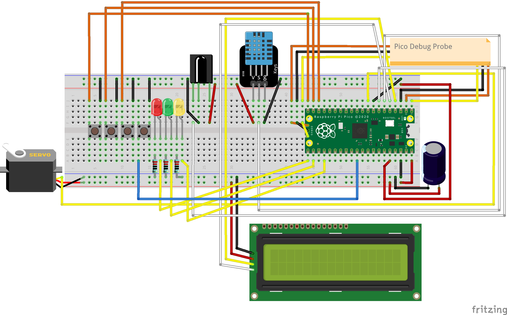

<br>

---
**LEGAL DISCLAIMER:**
The information, tools, and code provided in this repository and course are strictly for educational, research, and defensive purposes only. 

You are explicitly prohibited from using any materials contained herein to access, test, modify, or exploit any device, network, or system that you do not own 100% or for which you do not have explicit, documented, and legally binding authorization to interact with.

By using this repository and course, you acknowledge and agree that:
1. Any illegal, unauthorized, or malicious use of this information is solely your responsibility.
2. The author(s) and contributor(s) of this repository and course shall not be held liable for any damages, legal repercussions, criminal charges, or unauthorized actions resulting from the use, misuse, or abuse of the contents herein.
3. You will comply with all applicable local, state, national, and international laws regarding cybersecurity and computer fraud.

**IF YOU DO NOT AGREE WITH THESE TERMS, DO NOT USE THIS REPOSITORY AND COURSE.**
---

<br>

## FREE Reverse Engineering Self-Study Course [HERE](https://github.com/mytechnotalent/Reverse-Engineering)

<br>

# Today's Tutorial [November 13, 2026]
## Lesson 355: AVR Assembler Course (Chapter 009: Servo Motor)
This lesson will teach you how to control a mechanical Servo Motor by generating precise Pulse Width Modulation (PWM) signals using Timer1 in pure AVR assembly.

-> Click [HERE](https://github.com/mytechnotalent/Assembler/blob/main/lessons/009/lesson.md) to read the lesson and see the code.

<br>

# Embedded Hacking
A FREE comprehensive step-by-step embedded hacking course covering Embedded Software Development to Reverse Engineering.

VIDEO PROMO [HERE](https://www.youtube.com/watch?v=aD7X9sXirF8)

<br>

# FREE Book [Download](https://github.com/mytechnotalent/Embedded-Hacking/blob/main/textbook/Embedded-Hacking.pdf)

<br>

# Required Skills
Students must have a working understanding of the following items:

- **Intermediate C Programming:** In particular, you must understand how pointers reference memory addresses which we will use to perform live variable hijacking.
  - Training Link [HERE](https://www.learn-c.org)
- **Bare-Metal Embedded Systems Assembly Basics:** You must have experience with bare-metal assembly as we will be using this extensively throughout the entire course specifically with GDB and Ghidra.
  - Training Link [HERE](https://azeria-labs.com/writing-arm-assembly-part-1)
- **Computer Architecture Basics (Registers & Stack):** You need a working mental model of how a CPU/MCU uses registers and the stack to follow the boot process and function calls.
  - Training Link [HERE](https://www.geeksforgeeks.org/computer-science-fundamentals/what-is-register-memory)
  - Training Link [HERE](https://www.geeksforgeeks.org/computer-organization-architecture/memory-stack-organization-in-computer-architecture)
- **Command Line Interface (CLI) Proficiency:** You must be comfortable navigating directories and executing commands in a terminal to run the necessary OpenOCD and GDB tools.
  - Training Link [HERE](https://www.freecodecamp.org/news/command-line-commands-cli-tutorial)
- **Breadboarding Proficiency:** You must be comfortable demonstrating breadboard proficiency by efficiently prototyping circuits and integrating diverse peripherals, sensors, and microcontrollers.
  - Training Video [HERE](https://www.youtube.com/watch?v=fq6U5Y14oM4)

<br>

# Hardware

### Reference Diagrams & Schematics
- [Fritzing Project](https://github.com/mytechnotalent/Embedded-Hacking/blob/main/hardware/EHP2.fzz)
- [Breadboard Diagram](https://github.com/mytechnotalent/Embedded-Hacking/blob/main/hardware/EHP2_bb.png)
- [Pico 2 Pinout](https://github.com/mytechnotalent/Embedded-Hacking/blob/main/hardware/pico-2-r4-pinout.svg)
- [Debug Probe Wiring](https://github.com/mytechnotalent/Embedded-Hacking/blob/main/hardware/dp.png)

### Required Components & Sensors
The following hardware parts and sensors are used throughout the course experiments, projects, and live CTFs:
- [1x Full-size Breadboard (Long)](https://www.amazon.com/s?k=full+size+breadboard)
- [1x Assorted Jumper Wires (Male-to-Male, Male-to-Female, Female-to-Female)](https://www.amazon.com/s?k=breadboard+jumper+wires+assortment)
- [1x Raspberry Pi Pico 2 w/ Header](https://www.amazon.com/s?k=raspberry+pi+pico+2+with+pre-soldered+header)
- [1x Raspberry Pi Pico Debug Probe](https://www.amazon.com/s?k=raspberry+pi+debug+probe)
- [2x USB A-Male to USB Micro-B Cables (1 for Pico 2, 1 for Debug Probe)](https://www.amazon.com/s?k=micro+usb+cable+2+pack)
- [3x 5mm LEDs (1 Red, 1 Green, 1 Yellow)](https://www.amazon.com/s?k=5mm+led+kit)
- [3x 100, 220 or 330 Ohm Resistors (for LEDs)](https://www.amazon.com/s?k=resistor+assortment+kit)
- [1x Push Button (Tactile switch)](https://www.amazon.com/s?k=tactile+push+button+assortment)
- [1x 1602 LCD (with PCF8574 I2C backpack)](https://www.amazon.com/s?k=1602+lcd+i2c+module)
- [1x DHT11 Temperature & Humidity Sensor](https://www.amazon.com/s?k=dht11+temperature+and+humidity+sensor)
- [1x SG90 Servo Motor](https://www.amazon.com/s?k=sg90+micro+servo+motor)
- [1x 1000uF 25V Capacitor](https://www.amazon.com/Cionyce-Capacitor-Electrolytic-CapacitorsMicrowave/dp/B0B63CCQ2N)
- [1x 100pcs 100nF DIP Ceramic Disc Capacitor](https://www.amazon.com/dp/B09XV2H8JQ)
- [1x Infrared (IR) Receiver (VS1838B)](https://www.amazon.com/s?k=vs1838b+ir+receiver+module)
- [1x Infrared (IR) Remote Controller (NEC-compatible)](https://www.amazon.com/s?k=arduino+ir+remote+control)
- [1x u-blox NEO-6M GPS Receiver Module (with Active Antenna)](https://www.amazon.com/Navigation-Positioning-Microcontroller-Compatible-Sensitivity/dp/B084MK8BS2)
- [2x REYAX RYLR998 868/915MHz LoRa Transceiver Modules (1x Pico 2, 1x Computer)](https://www.amazon.com/dp/B099RM1XMG)
- [1x FT232RL USB to TTL Serial Adapter Module](https://www.amazon.com/FT232RL-Serial-Adapter-Module-Arduino/dp/B0FHP71BCQ)

<br><br>

# Breadboard Design


<br>

# Development Environment Setup

Everything installs natively on Windows, macOS (Apple Silicon), and Linux x64 — **no VM required**. The core toolchain (Pico SDK, the full Arm GNU Toolchain — `arm-none-eabi-gcc`, `arm-none-eabi-gdb`, `arm-none-eabi-nm`, `objdump` — `picotool`, and OpenOCD) comes from the **Raspberry Pi Pico VS Code extension**, which installs it all under `~/.pico-sdk` on every platform. You then add two reverse-engineering tools and a serial monitor. `arm-none-eabi-gdb` is what the GDB and Binary Ninja (GDB MI) debugging labs use.

## Windows x64

1. Install [VS Code](https://code.visualstudio.com/), [Git for Windows](https://git-scm.com/download/win), and [Python 3](https://www.python.org/downloads/) (check **Add python.exe to PATH**).
2. In VS Code open **Extensions**, search **Raspberry Pi Pico**, install it, and choose **Pico 2** as the board when prompted. This pulls the Pico SDK, Arm GNU Toolchain (includes `arm-none-eabi-gdb`), `picotool`, and OpenOCD.
3. Install [Binary Ninja Personal](https://binary.ninja/) and activate the license.
4. Install [Ghidra](https://github.com/NationalSecurityAgency/ghidra/releases) and [Eclipse Temurin JDK 21](https://adoptium.net/temurin/releases/?version=21).
5. Serial monitor: [PuTTY](https://www.putty.org/).

## macOS Apple Silicon

```bash
brew install cmake ninja
```

1. Install [VS Code](https://code.visualstudio.com/), then the **Raspberry Pi Pico** extension (choose **Pico 2**). This installs the Pico SDK, Arm GNU Toolchain (includes `arm-none-eabi-gdb`), `picotool`, and OpenOCD.
2. Install [Binary Ninja Personal](https://binary.ninja/) and activate the license.
3. Install Ghidra and JDK 21: `brew install --cask temurin@21`, then the [Ghidra release](https://github.com/NationalSecurityAgency/ghidra/releases).
4. Serial monitor: `screen` (built in).

> Use the Apple Silicon Homebrew at `/opt/homebrew`. If `file "$(which cmake)"` reports `x86_64`, an Intel Homebrew at `/usr/local` is shadowing it — put `/opt/homebrew/bin` first on your `PATH`. Do **not** fix this with Rosetta; it produces debugger failures that look like bugs.

## Linux x64

```bash
sudo apt update
sudo apt install git python3 cmake ninja-build build-essential screen
```

1. Install [VS Code](https://code.visualstudio.com/), then the **Raspberry Pi Pico** extension (choose **Pico 2**). This installs the Pico SDK, Arm GNU Toolchain (includes `arm-none-eabi-gdb`), `picotool`, and OpenOCD.
2. Install [Binary Ninja Personal](https://binary.ninja/) and activate the license.
3. Install Ghidra and JDK 21 (`sudo apt install openjdk-21-jdk`, then the [Ghidra release](https://github.com/NationalSecurityAgency/ghidra/releases)).
4. Serial monitor: `screen` or `minicom`.

## Example: Compile and Flash `0x0001 hello, world`

The **build** step is identical on all three platforms — CMake and Ninja are cross-platform, and the Pico extension's `~/.pico-sdk/cmake/pico-vscode.cmake` supplies the SDK, toolchain, and `picotool` paths on every OS. Only the **flash** and **serial** steps differ, so each platform is shown in full below. All three flash over the Debug Probe with SWD (`program <bin> 0x10000000 verify reset exit`) — no BOOTSEL, no UF2.

### Windows x64

```powershell
cd WEEK01\0x0001_hello-world
cmake -B build -G Ninja -DPICO_BOARD=pico2 -DPICO_PLATFORM=rp2350 -DCMAKE_BUILD_TYPE=Release
cmake --build build
..\..\flash.ps1 build\0x0001_hello-world.bin
```
Serial monitor: **PuTTY** -> *Serial* -> the Debug Probe's COM port -> **115200**.

### macOS Apple Silicon

```bash
cd WEEK01/0x0001_hello-world
cmake -B build -G Ninja -DPICO_BOARD=pico2 -DPICO_PLATFORM=rp2350 -DCMAKE_BUILD_TYPE=Release
cmake --build build
../../flash.sh build/0x0001_hello-world.bin
screen /dev/cu.usbmodem* 115200
```

### Linux x64

```bash
cd WEEK01/0x0001_hello-world
cmake -B build -G Ninja -DPICO_BOARD=pico2 -DPICO_PLATFORM=rp2350 -DCMAKE_BUILD_TYPE=Release
cmake --build build
../../flash.sh build/0x0001_hello-world.bin
screen /dev/ttyACM0 115200
```

You should see `hello, world` repeat at 115200.

> **If CMake cannot find the SDK or toolchain** (for example you installed the toolchain yourself instead of via the VS Code extension), pass them explicitly:
> ```bash
> cmake -B build -G Ninja -DPICO_BOARD=pico2 -DPICO_PLATFORM=rp2350 -DCMAKE_BUILD_TYPE=Release \
>   -DPICO_SDK_PATH="$HOME/.pico-sdk/sdk/2.2.0" \
>   -DPICO_TOOLCHAIN_PATH="$HOME/.pico-sdk/toolchain/14_2_Rel1"
> ```
> On Windows use forward slashes, e.g. `C:/Users/<you>/.pico-sdk/sdk/2.2.0`.

Debug Probe wiring is [HERE](https://github.com/mytechnotalent/Embedded-Hacking/blob/main/hardware/dp.png).

<br>

# Datasheets & References

This repository includes the complete set of authoritative technical reference manuals and datasheets required for professional embedded engineering and reverse engineering on the Raspberry Pi Pico 2:

### [RP2350 Datasheet](https://github.com/mytechnotalent/Embedded-Hacking/blob/main/datasheets/rp2350-datasheet.pdf)
*RP2350 Datasheet: A microcontroller by Raspberry Pi (1,380 pages)*
- **Core Architecture:** Dual Arm Cortex-M33 / Hazard3 RISC-V processors running up to 150MHz, 520kB on-chip SRAM across 10 striped banks, and 8kB one-time-programmable (OTP) storage.
- **System Memory Map (Chapter 2):** Complete physical address map covering external XIP Flash (`0x10000000`), SRAM (`0x20000000`), APB/AHB peripherals (`0x40000000`), and core-local Single-Cycle I/O (`0xd0000000`).
- **Peripheral Register Definitions:** Exhaustive register layouts, reset states, and bitfield descriptions for all 52 peripherals: `IO_BANK0` (pin multiplexing & `FUNCSEL`), `PADS_BANK0` (electrical drive strength, pulls, and Schmitt triggers), `UART0`/`UART1`, `SPI0`/`SPI1`, `I2C0`/`I2C1`, `PWM`, `DMA`, `CLOCKS`, and `WATCHDOG`.
- **Programmable I/O (PIO):** Comprehensive architectural guide for the 3 on-chip PIO blocks (`PIO0`, `PIO1`, `PIO2`) with 12 state machines for deterministic, high-speed custom hardware protocols.
- **Fast GPIO Coprocessor:** Hardware specification for single-cycle atomic GPIO output and direction control via dedicated ARM coprocessor instructions (`mcrr p0`).
- **Bootrom & Hardware Security:** Covers the internal mask ROM boot flow, secure boot signature verification, SHA-256 cryptographic accelerator, and OTP key protection.

### [Raspberry Pi Pico C/C++ SDK](https://github.com/mytechnotalent/Embedded-Hacking/blob/main/datasheets/raspberry-pi-pico-c-sdk.pdf)
*Raspberry Pi Pico-series C/C++ SDK: Libraries and tools for development (821 pages)*
- **SDK Architecture & Build System:** CMake configuration, target library linking (`pico_stdlib`, `hardware_gpio`), compiler flags, and the UF2 binary packaging workflow.
- **Hardware Drivers (`hardware_*`):** Low-level driver API documentation:
  - `hardware_gpio`: Functions like `gpio_init()`, `gpio_set_dir()`, `gpio_put()`, `gpio_get()`, and hardware pin interrupt handling.
  - `hardware_uart`: Serial communication initialization (`uart_init()`, baud rate dividers, FIFO handling).
  - `hardware_dma`: Channel configuration, transfer sizing, and background memory pacing.
  - `hardware_clocks` & `hardware_resets`: PLL frequency configuration and peripheral unreset sequencing.
- **High-Level Runtimes (`pico_*`):** Standard I/O stream redirection (`stdio_init_all()` over UART/USB CDC), multicore core 1 launching (`pico_multicore`), sleep timers, and thread synchronization.
- **Hardware Structs (`hardware_structs`):** C struct definitions matching chip MMIO registers 1-to-1, used by reverse engineers to reconstruct decompiled peripheral accesses.

### [Arm Cortex-M33 Technical Reference Manual](https://github.com/mytechnotalent/Embedded-Hacking/blob/main/datasheets/arm_cortex_m33_trm_100230_0100_03_en.pdf)
*Arm® Cortex®-M33 Processor Technical Reference Manual (Doc ID: 100230_0100_03_en, 168 pages)*
- **Core Microarchitecture:** 3-stage in-order pipeline, Harvard bus architecture (instruction and data buses), integer execution core, and optional IEEE 754 single/double-precision floating-point unit (FPU).
- **Nested Vectored Interrupt Controller (NVIC):** Interrupt priorities, exception vector table mapping, low-latency interrupt entry, and hardware tail-chaining mechanics.
- **Memory Protection & TrustZone:** Memory Protection Unit (MPU) supporting up to 16 configurable regions, and Security Attribution Unit (SAU) for hardware-enforced Secure vs Non-secure domain isolation.
- **CoreSight Debug & Trace:** Debug Access Port (DAP) used by OpenOCD and the Raspberry Pi Debug Probe, Flash Patch and Breakpoint unit (FPB), Data Watchpoint and Trace (DWT), and Instrumentation Trace Macrocell (ITM).
- **Coprocessor Interface:** Bus architecture connecting hardware accelerators directly to the core (utilized by the RP2350 for single-cycle GPIO and math acceleration).

### [Armv8-M Architecture Reference Manual (DDI0553B)](https://github.com/mytechnotalent/Embedded-Hacking/blob/main/datasheets/DDI0553B_y_armv8m_arm.pdf)
*Armv8-M Architecture Reference Manual (Doc ID: DDI0553B, 2,149 pages)*
- **Authoritative Instruction Set Reference (Section C2.4, Pages 527–1454):** Complete alphabetical encyclopedia of every assembly instruction supported by the RP2350 Cortex-M33:
  - Data processing: `MOV`, `MOVS`, `MVN`, `ADD`, `SUB`, `MUL`, `SDIV`, `UDIV`, `AND`, `ORR`, `EOR`, `BIC`.
  - Memory load/store: `LDR`, `STR`, `LDRB`, `STRB`, `LDRH`, `STRH`, `LDRD`, `STRD`, `LDM`, `STM`, `PUSH`, `POP`.
  - Control flow: `B`, `BL`, `BX`, `BLX`, `CBZ`, `CBNZ`, `TBB`, `TBH`.
  - Coprocessor instructions: `MCR`, `MRC`, `MCRR`, `MRRC` (used by the RP2350 fast GPIO block).
  - Floating-point instructions: `VMOV`, `VADD`, `VSUB`, `VMUL`, `VDIV`, `VCMP`, `VMRS`, `VMSR`.
- **Machine Opcode Encodings:** Exact 16-bit Thumb and 32-bit Thumb-2 binary bit patterns for every instruction, essential for binary patching and shellcode analysis.
- **Programmer's Model:** General-purpose registers (`r0`–`r12`), Stack Pointers (`SP`/`MSP`/`PSP`), Link Register (`LR`), Program Counter (`PC`), Status Registers (`APSR`, `IPSR`, `EPSR`, `xPSR`), and Special Registers (`CONTROL`, `PRIMASK`).
- **Exception Mechanics:** Hardware state stacking upon exception entry (`r0`-`r3`, `r12`, `lr`, `pc`, `xPSR`), EXC_RETURN values, and fault analysis (HardFault, MemManage, BusFault, UsageFault).

### [Procedure Call Standard for the Arm Architecture (AAPCS32)](https://github.com/mytechnotalent/Embedded-Hacking/blob/main/datasheets/aapcs32.pdf)
*Procedure Call Standard for the Arm® Architecture (AAPCS32 / ABI, 41 pages)*
- **Register Allocation Contract:** Defines caller and callee responsibilities across function calls:
  - Parameter passing: `r0`–`r3` pass the first four 32-bit parameters (or 64-bit pairs like `r0`-`r1` and `r2`-`r3`). Additional parameters are pushed to the stack.
  - Return values: `r0` returns 32-bit scalar values; `r0`-`r1` returns 64-bit integers and 64-bit IEEE 754 `double` floats.
  - Scratch / Caller-Saved registers: `r0`–`r3`, `r12` (`IP`), and `r14` (`LR`) can be freely overwritten by called functions.
  - Preserved / Callee-Saved registers: `r4`–`r11` must be preserved across function calls (saved via `push` in prologue and restored via `pop` in epilogue).
- **Floating-Point ABI:** Register allocation for hardware VFP registers (`s0`–`s15`, `d0`–`d7`) vs software floating-point library calls.
- **Data Alignment & Struct Packing:** Alignment rules (1, 2, 4, 8 bytes), structure member padding, and composite type memory layouts.

### [ARM Application Note 132 (advnote132)](https://github.com/mytechnotalent/Embedded-Hacking/blob/main/datasheets/advnote132.pdf)
*ABI Advisory Note – SP must be 8-byte aligned on entry to AAPCS-conforming functions (10 pages)*
- **The 8-Byte Stack Alignment Rule:** Mandates that the Stack Pointer (`SP`) must be aligned to an 8-byte (doubleword) boundary at all public function call interfaces.
- **Why Unaligned Stacks Fail:** 64-bit memory operations (`LDRD`, `STRD`) and double-precision floating-point operations require 8-byte alignment; misaligned stacks trigger hardware alignment faults or severe memory bus performance penalties.
- **Prologue Disassembly Deconstruction:** Explains why compiler-generated assembly frequently emits `push {r4, lr}` (saving two 32-bit registers) even when `r4` is completely unused—the extra register push serves as deliberate padding to keep `SP` strictly 8-byte aligned!

<br>

# Syllabus

## Week 1
Introduction and Overview of Embedded Reverse Engineering: Ethics, Scoping, and Basic Concepts

### Week 1 Slides [HERE](https://github.com/mytechnotalent/Embedded-Hacking/blob/main/WEEK01/WEEK01-SLIDES.pdf)

### Week 1 Notebook [HERE](https://github.com/mytechnotalent/Embedded-Hacking/blob/main/WEEK01/WEEK01.md)

### Week 1a Notebook [HERE](https://github.com/mytechnotalent/Embedded-Hacking/blob/main/WEEK01/WEEK01a.md)

### Chapter 1: hello, world
This chapter covers the basics of setting up a dev environment and basic template firmware for the Pico 2 MCU in addition to printing hello, world.

-> Click [HERE](https://github.com/mytechnotalent/Embedded-Hacking/blob/main/textbook/Embedded-Hacking.pdf) to read the FREE pdf book.

### Chapter 2: Debugging hello, world
This chapter covers the debugging of our firmware for the Pico 2 MCU hello, world program.

-> Click [HERE](https://github.com/mytechnotalent/Embedded-Hacking/blob/main/textbook/Embedded-Hacking.pdf) to read the FREE pdf book.

## Week 2
Hello, World - Debugging and Hacking Basics: Debugging and Hacking a Basic Program for the Pico 2

### Week 2 Slides [HERE](https://github.com/mytechnotalent/Embedded-Hacking/blob/main/WEEK02/WEEK02-SLIDES.pdf)

### Week 2 Notebook [HERE](https://github.com/mytechnotalent/Embedded-Hacking/blob/main/WEEK02/WEEK02.md)

### Chapter 3: Hacking hello, world
This chapter covers the hacking of our firmware for the Pico 2 MCU hello, world program.

-> Click [HERE](https://github.com/mytechnotalent/Embedded-Hacking/blob/main/textbook/Embedded-Hacking.pdf) to read the FREE pdf book.

## Week 3
Embedded System Analysis: Understanding the RP2350 Architecture w/ Comprehensive Firmware Analysis

### Week 3 Slides [HERE](https://github.com/mytechnotalent/Embedded-Hacking/blob/main/WEEK03/WEEK03-SLIDES.pdf)

### Week 3 Notebook [HERE](https://github.com/mytechnotalent/Embedded-Hacking/blob/main/WEEK03/WEEK03.md)

### Ghidra Patching Tutorial [HERE](https://github.com/mytechnotalent/Embedded-Hacking/blob/main/WEEK03/GHIDRA_PATCHING_TUTORIAL.md)

### CTF-01 Instructions [HERE](https://github.com/mytechnotalent/Embedded-Hacking/blob/main/WEEK04/0x0001b_ctf/CTF-01-I.md)

### CTF-01 Rubric [HERE](https://github.com/mytechnotalent/Embedded-Hacking/blob/main/WEEK04/0x0001b_ctf/CTF-01-R.md)

### CTF-01 Solution [HERE](https://github.com/mytechnotalent/Embedded-Hacking/blob/main/WEEK04/0x0001b_ctf/CTF-01-S.md)

### CTF-01 BIN [HERE](https://github.com/mytechnotalent/Embedded-Hacking/blob/main/WEEK04/0x0001b_ctf/CTF-01.bin)

### CTF-01 UF2 [HERE](https://github.com/mytechnotalent/Embedded-Hacking/blob/main/WEEK04/0x0001b_ctf/CTF-01.uf2)

### Chapter 4: Embedded System Analysis
This chapter covers a comprehensive embedded system analysis reviewing parts of the RP2350 datasheet and helpful firmware analysis tools.

-> Click [HERE](https://github.com/mytechnotalent/Embedded-Hacking/blob/main/textbook/Embedded-Hacking.pdf) to read the FREE pdf book.

## Week 4
Variables in Embedded Systems: Debugging and Hacking Variables w/ GPIO Output Basics

### Week 4 Slides [HERE](https://github.com/mytechnotalent/Embedded-Hacking/blob/main/WEEK04/WEEK04-SLIDES.pdf)

### Week 4 Notebook [HERE](https://github.com/mytechnotalent/Embedded-Hacking/blob/main/WEEK04/WEEK04.md)

### Week 4a Notebook [HERE](https://github.com/mytechnotalent/Embedded-Hacking/blob/main/WEEK04/WEEK04a.md)

### RP2350 SVD [HERE](https://github.com/mytechnotalent/Embedded-Hacking/blob/main/WEEK04/rp2350.svd)

### Chapter 5: Intro To Variables
This chapter covers an introduction to variables as it relates to embedded development on the Pico 2.

-> Click [HERE](https://github.com/mytechnotalent/Embedded-Hacking/blob/main/textbook/Embedded-Hacking.pdf) to read the FREE pdf book.

### Chapter 6: Debugging Intro To Variables
This chapter covers debugging an introduction to variables as it relates to embedded development on the Pico 2.

-> Click [HERE](https://github.com/mytechnotalent/Embedded-Hacking/blob/main/textbook/Embedded-Hacking.pdf) to read the FREE pdf book.

### Chapter 7: Hacking Intro To Variables
This chapter covers hacking an introduction to variables as it relates to embedded development on the Pico 2.

-> Click [HERE](https://github.com/mytechnotalent/Embedded-Hacking/blob/main/textbook/Embedded-Hacking.pdf) to read the FREE pdf book.

### Chapter 8: Uninitialized Variables
This chapter covers uninitialized variables as well as an intro to GPIO outputs as we blink an LED as it relates to embedded development on the Pico 2.

-> Click [HERE](https://github.com/mytechnotalent/Embedded-Hacking/blob/main/textbook/Embedded-Hacking.pdf) to read the FREE pdf book.

### Chapter 9: Debugging Uninitialized Variables
This chapter covers debugging uninitialized variables as well as an intro to GPIO outputs as we blink an LED as it relates to embedded development on the Pico 2.

-> Click [HERE](https://github.com/mytechnotalent/Embedded-Hacking/blob/main/textbook/Embedded-Hacking.pdf) to read the FREE pdf book.

### Chapter 10: Hacking Uninitialized Variables
This chapter covers hacking uninitialized variables as well as an intro to GPIO outputs as we blink an LED as it relates to embedded development on the Pico 2.

-> Click [HERE](https://github.com/mytechnotalent/Embedded-Hacking/blob/main/textbook/Embedded-Hacking.pdf) to read the FREE pdf book.

## Week 5
Integers and Floats in Embedded Systems: Debugging and Hacking Integers and Floats w/ Intermediate GPIO Output Assembler Analysis

### Week 5 Slides [HERE](https://github.com/mytechnotalent/Embedded-Hacking/blob/main/WEEK05/WEEK05-SLIDES.pdf)

### Week 5 Notebook [HERE](https://github.com/mytechnotalent/Embedded-Hacking/blob/main/WEEK05/WEEK05.md)

### Week 5a Notebook [HERE](https://github.com/mytechnotalent/Embedded-Hacking/blob/main/WEEK05/WEEK05a.md)

### Float/Hex Converter Tool [HERE](https://github.com/mytechnotalent/Embedded-Hacking/blob/main/WEEK05/float_hex_converter.py)

### Chapter 11: Integer Data Type
This chapter covers the integer data type in addition to a deeper assembler dive into GPIO outputs as it relates to embedded development on the Pico 2.

-> Click [HERE](https://github.com/mytechnotalent/Embedded-Hacking/blob/main/textbook/Embedded-Hacking.pdf) to read the FREE pdf book.

### Chapter 12: Debugging Integer Data Type
This chapter covers debugging the integer data type in addition to a deeper assembler dive into GPIO outputs as it relates to embedded development on the Pico 2.

-> Click [HERE](https://github.com/mytechnotalent/Embedded-Hacking/blob/main/textbook/Embedded-Hacking.pdf) to read the FREE pdf book.

### Chapter 13: Hacking Integer Data Type
This chapter covers hacking the integer data type in addition to a deeper assembler dive into GPIO outputs as it relates to embedded development on the Pico 2.

-> Click [HERE](https://github.com/mytechnotalent/Embedded-Hacking/blob/main/textbook/Embedded-Hacking.pdf) to read the FREE pdf book.

### Chapter 14: Floating-Point Data Type
This chapter covers the floating-point data type as it relates to embedded development on the Pico 2.

-> Click [HERE](https://github.com/mytechnotalent/Embedded-Hacking/blob/main/textbook/Embedded-Hacking.pdf) to read the FREE pdf book.

### Chapter 15: Debugging Floating-Point Data Type
This chapter covers debugging the floating-point data type as it relates to embedded development on the Pico 2.

-> Click [HERE](https://github.com/mytechnotalent/Embedded-Hacking/blob/main/textbook/Embedded-Hacking.pdf) to read the FREE pdf book.

### Chapter 16: Hacking Floating-Point Data Type
This chapter covers hacking the floating-point data type as it relates to embedded development on the Pico 2.

-> Click [HERE](https://github.com/mytechnotalent/Embedded-Hacking/blob/main/textbook/Embedded-Hacking.pdf) to read the FREE pdf book.

### Chapter 17: Double Floating-Point Data Type
This chapter covers the double floating-point data type as it relates to embedded development on the Pico 2.

-> Click [HERE](https://github.com/mytechnotalent/Embedded-Hacking/blob/main/textbook/Embedded-Hacking.pdf) to read the FREE pdf book.

### Chapter 18: Debugging Double Floating-Point Data Type
This chapter covers debugging the double floating-point data type as it relates to embedded development on the Pico 2.

-> Click [HERE](https://github.com/mytechnotalent/Embedded-Hacking/blob/main/textbook/Embedded-Hacking.pdf) to read the FREE pdf book.

### Chapter 19: Hacking Double Floating-Point Data Type
This chapter covers hacking the double floating-point data type as it relates to embedded development on the Pico 2.

-> Click [HERE](https://github.com/mytechnotalent/Embedded-Hacking/blob/main/textbook/Embedded-Hacking.pdf) to read the FREE pdf book.

## Week 6
Static Variables in Embedded Systems: Debugging and Hacking Static Variables w/ GPIO Input Basics

### Classified Brief 0x01 [HERE](https://github.com/mytechnotalent/Embedded-Hacking/blob/main/WEEK06/0x0011a_cb/CLASSIFIED-BRIEF-0x01.md)

### Classified Brief 0x01 BIN [HERE](https://github.com/mytechnotalent/Embedded-Hacking/blob/main/WEEK06/0x0011a_cb/0x0011a_cb.bin)

### Classified Brief 0x01 UF2 [HERE](https://github.com/mytechnotalent/Embedded-Hacking/blob/main/WEEK06/0x0011a_cb/0x0011a_cb.uf2)

### Week 6 Slides [HERE](https://github.com/mytechnotalent/Embedded-Hacking/blob/main/WEEK06/WEEK06-SLIDES.pdf)

### Week 6 Notebook [HERE](https://github.com/mytechnotalent/Embedded-Hacking/blob/main/WEEK06/WEEK06.md)

### Chapter 20: Static Variables
This chapter covers static variables as well as an intro to GPIO inputs as we work with push buttons as it relates to embedded development on the Pico 2.

-> Click [HERE](https://github.com/mytechnotalent/Embedded-Hacking/blob/main/textbook/Embedded-Hacking.pdf) to read the FREE pdf book.

### Chapter 21: Debugging Static Variables
This chapter covers debugging static variables as well as an intro to GPIO inputs as we work with push buttons as it relates to embedded development on the Pico 2.

-> Click [HERE](https://github.com/mytechnotalent/Embedded-Hacking/blob/main/textbook/Embedded-Hacking.pdf) to read the FREE pdf book.

### Chapter 22: Hacking Static Variables
This chapter covers hacking static variables as well as an intro to GPIO inputs as we work with push buttons as it relates to embedded development on the Pico 2.

-> Click [HERE](https://github.com/mytechnotalent/Embedded-Hacking/blob/main/textbook/Embedded-Hacking.pdf) to read the FREE pdf book.

## Week 7
Constants in Embedded Systems: Debugging and Hacking Constants w/ 1602 LCD I2C Basics

### Classified Brief 0x02 [HERE](https://github.com/mytechnotalent/Embedded-Hacking/blob/main/WEEK07/0x0014a_cb/CLASSIFIED-BRIEF-0x02.md)

### Classified Brief 0x02 BIN [HERE](https://github.com/mytechnotalent/Embedded-Hacking/blob/main/WEEK07/0x0014a_cb/0x0014a_cb.bin)

### Classified Brief 0x02 UF2 [HERE](https://github.com/mytechnotalent/Embedded-Hacking/blob/main/WEEK07/0x0014a_cb/0x0014a_cb.uf2)

### Week 7 Slides [HERE](https://github.com/mytechnotalent/Embedded-Hacking/blob/main/WEEK07/WEEK07-SLIDES.pdf)

### Week 7 Notebook [HERE](https://github.com/mytechnotalent/Embedded-Hacking/blob/main/WEEK07/WEEK07.md)

### Chapter 23: Constants
This chapter covers constants as well as an intro to I2C as we work a 1602 LCD as it relates to embedded development on the Pico 2.

-> Click [HERE](https://github.com/mytechnotalent/Embedded-Hacking/blob/main/textbook/Embedded-Hacking.pdf) to read the FREE pdf book.

### Chapter 24: Debugging Constants
This chapter covers debugging constants as well as an intro to I2C as we work a 1602 LCD as it relates to embedded development on the Pico 2.

-> Click [HERE](https://github.com/mytechnotalent/Embedded-Hacking/blob/main/textbook/Embedded-Hacking.pdf) to read the FREE pdf book.

### Chapter 25: Hacking Constants
This chapter covers hacking constants as well as an intro to I2C as we work a 1602 LCD as it relates to embedded development on the Pico 2.

-> Click [HERE](https://github.com/mytechnotalent/Embedded-Hacking/blob/main/textbook/Embedded-Hacking.pdf) to read the FREE pdf book.

## Week 8
### Midterm Exam

### CTF-02 Instructions [HERE](https://github.com/mytechnotalent/Embedded-Hacking/blob/main/WEEK07/0x0017a_ctf/CTF-02-I.md)

### CTF-02 Rubric [HERE](https://github.com/mytechnotalent/Embedded-Hacking/blob/main/WEEK07/0x0017a_ctf/CTF-02-R.md)

### CTF-02 Solution [HERE](https://github.com/mytechnotalent/Embedded-Hacking/blob/main/WEEK07/0x0017a_ctf/CTF-02-S.md)

### CTF-02 BIN [HERE](https://github.com/mytechnotalent/Embedded-Hacking/blob/main/WEEK07/0x0017a_ctf/CTF-02.bin)

### CTF-02 UF2 [HERE](https://github.com/mytechnotalent/Embedded-Hacking/blob/main/WEEK07/0x0017a_ctf/CTF-02.uf2)

## Week 9
Operators in Embedded Systems: Debugging and Hacking Operators w/ DHT11 Temperature & Humidity Sensor Single-Wire Protocol Basics

### Classified Brief 0x03 [HERE](https://github.com/mytechnotalent/Embedded-Hacking/blob/main/WEEK09/0x001aa_cb/CLASSIFIED-BRIEF-0x03.md)

### Classified Brief 0x03 BIN [HERE](https://github.com/mytechnotalent/Embedded-Hacking/blob/main/WEEK09/0x001aa_cb/0x001aa_cb.bin)

### Classified Brief 0x03 UF2 [HERE](https://github.com/mytechnotalent/Embedded-Hacking/blob/main/WEEK09/0x001aa_cb/0x001aa_cb.uf2)

### Week 9 Slides [HERE](https://github.com/mytechnotalent/Embedded-Hacking/blob/main/WEEK09/WEEK09-SLIDES.pdf)

### Week 9 Notebook [HERE](https://github.com/mytechnotalent/Embedded-Hacking/blob/main/WEEK09/WEEK09.md)

### Chapter 26: Operators
This chapter covers operators as well as an intro to single-wire protocol as we work a DHT11 temperature and humidity sensor as it relates to embedded development on the Pico 2.

-> Click [HERE](https://github.com/mytechnotalent/Embedded-Hacking/blob/main/textbook/Embedded-Hacking.pdf) to read the FREE pdf book.

### Chapter 27: Debugging Operators
This chapter covers debugging operators as well as an intro to single-wire protocol as we work a DHT11 temperature and humidity sensor as it relates to embedded development on the Pico 2.

-> Click [HERE](https://github.com/mytechnotalent/Embedded-Hacking/blob/main/textbook/Embedded-Hacking.pdf) to read the FREE pdf book.

### Chapter 28: Hacking Operators
This chapter covers hacking operators as well as an intro to single-wire protocol as we work a DHT11 temperature and humidity sensor as it relates to embedded development on the Pico 2.

-> Click [HERE](https://github.com/mytechnotalent/Embedded-Hacking/blob/main/textbook/Embedded-Hacking.pdf) to read the FREE pdf book.

## Week 10
Conditionals in Embedded Systems: Debugging and Hacking Static & Dynamic Conditionals w/ SG90 Servo Motor PWM Basics

### Classified Brief 0x04 [HERE](https://github.com/mytechnotalent/Embedded-Hacking/blob/main/WEEK10/0x001da_cb/CLASSIFIED-BRIEF-0x04.md)

### Classified Brief 0x04 BIN [HERE](https://github.com/mytechnotalent/Embedded-Hacking/blob/main/WEEK10/0x001da_cb/0x001da_cb.bin)

### Classified Brief 0x04 UF2 [HERE](https://github.com/mytechnotalent/Embedded-Hacking/blob/main/WEEK10/0x001da_cb/0x001da_cb.uf2)

## Week 10 Slides [HERE](https://github.com/mytechnotalent/Embedded-Hacking/blob/main/WEEK10/WEEK10-SLIDES.pdf)

## Week 10 Notebook [HERE](https://github.com/mytechnotalent/Embedded-Hacking/blob/main/WEEK10/WEEK10.md)

### Chapter 29: Static Conditionals
This chapter covers static conditionals as well as an intro to PWM as we work a SG90 servo motor as it relates to embedded development on the Pico 2.

-> Click [HERE](https://github.com/mytechnotalent/Embedded-Hacking/blob/main/textbook/Embedded-Hacking.pdf) to read the FREE pdf book.

### Chapter 30: Debugging Static Conditionals
This chapter covers debugging static conditionals as well as an intro to PWM as we work a SG90 servo motor as it relates to embedded development on the Pico 2.

-> Click [HERE](https://github.com/mytechnotalent/Embedded-Hacking/blob/main/textbook/Embedded-Hacking.pdf) to read the FREE pdf book.

### Chapter 31: Hacking Static Conditionals
This chapter covers hacking static conditionals as well as an intro to PWM as we work a SG90 servo motor as it relates to embedded development on the Pico 2.

-> Click [HERE](https://github.com/mytechnotalent/Embedded-Hacking/blob/main/textbook/Embedded-Hacking.pdf) to read the FREE pdf book.

### Chapter 32: Dynamic Conditionals
This chapter covers dynamic conditionals as well as additional PWM examples as we work a SG90 servo motor as it relates to embedded development on the Pico 2.

-> Click [HERE](https://github.com/mytechnotalent/Embedded-Hacking/blob/main/textbook/Embedded-Hacking.pdf) to read the FREE pdf book.

### Chapter 33: Debugging Dynamic Conditionals
This chapter covers debugging dynamic conditionals as well as additional PWM examples as we work a SG90 servo motor as it relates to embedded development on the Pico 2.

-> Click [HERE](https://github.com/mytechnotalent/Embedded-Hacking/blob/main/textbook/Embedded-Hacking.pdf) to read the FREE pdf book.

### Chapter 34: Hacking Dynamic Conditionals
This chapter covers hacking dynamic conditionals as well as additional PWM examples as we work a SG90 servo motor as it relates to embedded development on the Pico 2.

-> Click [HERE](https://github.com/mytechnotalent/Embedded-Hacking/blob/main/textbook/Embedded-Hacking.pdf) to read the FREE pdf book.

## Week 11
Structures and Functions in Embedded Systems: Debugging and Hacking w/ IR Remote Control and NEC Protocol Basics

### Classified Brief 0x05 [HERE](https://github.com/mytechnotalent/Embedded-Hacking/blob/main/WEEK11/0x0020a_cb/CLASSIFIED-BRIEF-0x05.md)

### Classified Brief 0x05 BIN [HERE](https://github.com/mytechnotalent/Embedded-Hacking/blob/main/WEEK11/0x0020a_cb/0x0020a_cb.bin)

### Classified Brief 0x05 UF2 [HERE](https://github.com/mytechnotalent/Embedded-Hacking/blob/main/WEEK11/0x0020a_cb/0x0020a_cb.uf2)

## Week 11 Slides [HERE](https://github.com/mytechnotalent/Embedded-Hacking/blob/main/WEEK11/WEEK11-SLIDES.pdf)

## Week 11 Notebook [HERE](https://github.com/mytechnotalent/Embedded-Hacking/blob/main/WEEK11/WEEK11.md)

## Week 11a Secure Boot + Custom Bootloader Notebook [HERE](https://github.com/mytechnotalent/Embedded-Hacking/blob/main/WEEK11/WEEK11a.md)

### 0x0026a Custom Secure Bootloader [HERE](https://github.com/mytechnotalent/Embedded-Hacking/blob/main/WEEK11/0x0026a_custom-bootloader/README.md)

### 0x0026a Bootloader BIN [HERE](https://github.com/mytechnotalent/Embedded-Hacking/blob/main/WEEK11/0x0026a_custom-bootloader/0x0026a_bootloader.bin)

### 0x0026a Signed Application BIN [HERE](https://github.com/mytechnotalent/Embedded-Hacking/blob/main/WEEK11/0x0026a_custom-bootloader/0x0026a_app.bin)

### 0x0026a Manifest BIN [HERE](https://github.com/mytechnotalent/Embedded-Hacking/blob/main/WEEK11/0x0026a_custom-bootloader/manifest.bin)

### 0x0026a Full Secure Boot UF2 (bootloader + manifest + app) [HERE](https://github.com/mytechnotalent/Embedded-Hacking/blob/main/WEEK11/0x0026a_custom-bootloader/0x0026a_full.uf2)

### Chapter 35: Structures
This chapter covers structures as well as an intro to infrared basics as we work a infrared receiver and infrared remote controller as it relates to embedded development on the Pico 2.

-> Click [HERE](https://github.com/mytechnotalent/Embedded-Hacking/blob/main/textbook/Embedded-Hacking.pdf) to read the FREE pdf book.

### Chapter 36: Debugging Structures
This chapter covers debugging structures as well as an intro to infrared basics as we work a infrared receiver and infrared remote controller as it relates to embedded development on the Pico 2.

-> Click [HERE](https://github.com/mytechnotalent/Embedded-Hacking/blob/main/textbook/Embedded-Hacking.pdf) to read the FREE pdf book.

### Chapter 37: Hacking Structures
This chapter covers hacking structures as well as an intro to infrared basics as we work a infrared receiver and infrared remote controller as it relates to embedded development on the Pico 2.

-> Click [HERE](https://github.com/mytechnotalent/Embedded-Hacking/blob/main/textbook/Embedded-Hacking.pdf) to read the FREE pdf book.

### Chapter 38: Functions, w/ Param, w/ Return
This chapter covers functions, w/ params and w/ a return value as well as additional infrared examples as we work a infrared receiver and infrared remote controller it relates to embedded development on the Pico 2.

-> Click [HERE](https://github.com/mytechnotalent/Embedded-Hacking/blob/main/textbook/Embedded-Hacking.pdf) to read the FREE pdf book.

### Chapter 39: Debugging Functions, w/ Param, w/ Return
This chapter covers debugging functions, w/ params and w/ a return value as well as additional infrared examples as we work a infrared receiver and infrared remote controller as it relates to embedded development on the Pico 2.

-> Click [HERE](https://github.com/mytechnotalent/Embedded-Hacking/blob/main/textbook/Embedded-Hacking.pdf) to read the FREE pdf book.

### Chapter 40: Hacking Functions, w/ Param, w/ Return
This chapter covers hacking functions, w/ params and w/ a return value as it relates to embedded development on the Pico 2.

-> Click [HERE](https://github.com/mytechnotalent/Embedded-Hacking/blob/main/textbook/Embedded-Hacking.pdf) to read the FREE pdf book.

## Week 12
Unknown Firmware Debugging and Hacking

### Week 12 Story [HERE](https://github.com/mytechnotalent/Embedded-Hacking/blob/main/WEEK12/STORY.md) | [PDF](https://github.com/mytechnotalent/Embedded-Hacking/blob/main/WEEK12/STORY.pdf)

### Week 12 Capstone Notebook [HERE](https://github.com/mytechnotalent/Embedded-Hacking/blob/main/WEEK12/WEEK12.md)

### Week 12 Capstone Source [HERE](https://github.com/mytechnotalent/Embedded-Hacking/tree/main/WEEK12/0x002a_pale-horse)

## Week 13
Final Review – Embedded Debugging and Hacking Techniques w/ Advanced Firmware Analysis Q&A

## Week 14
### Final Projects

### Final Project Option 1: The InfuSafe Pro Incident
In the aftermath of a catastrophic medical device failure, you are thrust into the role of an FDA forensic investigator facing an impossible crisis: 23 patients dead, 100 million recalled insulin pumps sitting in warehouses worldwide, and 2.3 million lives hanging in the balance all while the only evidence remaining is raw binary firmware after a rogue engineer destroyed every line of source code before fleeing to Montenegro. Armed only with GDB, Ghidra, and the reverse engineering skills honed over the first seven weeks of this course, you must excavate the truth from machine code, identify the lethal bugs spawned by an AI code generator called "OopsieGPT," and determine whether these devices can be salvaged to save millions in underserved communities or if $4.7 billion in humanitarian medical technology must be incinerated. This is not a simulation; this is triage at the intersection of embedded systems security and human survival.

### Final Project Option 2: Operation Dark Eclipse
Forty-two stories beneath frozen tundra, a shadow intelligence alliance called Dark Eyes operates centrifuges enriching weapons-grade material for a first strike against Washington, D.C. and Agent NIGHTINGALE gave her life to extract the single firmware file that now sits before you. Conventional warfare cannot reach this fortress buried beneath rock and concrete, but you can: as the architect of a precision cyber weapon in the tradition of Stuxnet, you must reverse engineer the RP2350-based centrifuge controller, craft binary patches that double the spin speed while falsifying every sensor readout to show nominal operation, and execute the sabotage that will cascade-destroy their enrichment program and set their nuclear ambitions back a decade. Every skill from the entire semester ARM assembly, Ghidra analysis, IEEE-754 floating-point manipulation, branch modification, log desynchronization converges in this final mission. Agent NIGHTINGALE's seven-year-old daughter still watches the driveway, waiting for a mother who will never return. Honor that sacrifice. Complete the mission. Do not fail.

<br>

# Supplemental Material (Beyond the Scope of the Course)

## Pico 2 W C MeshCore Project

### MeshCore Bare RP2350 [HERE](https://github.com/mytechnotalent/meshcore-bare-rp2350) 

<br>

## Pico 2 Rust Drivers

### UART Driver [HERE](https://github.com/mytechnotalent/RP2350_Rust_UART_Driver)

### Blink Driver [HERE](https://github.com/mytechnotalent/RP2350_Rust_Blink_Driver)

### Button Driver [HERE](https://github.com/mytechnotalent/RP2350_Rust_Button_Driver)

<br>

## Pico 2 ARM Assembler Drivers

### UART Driver [HERE](https://github.com/mytechnotalent/RP2350_UART_Driver)

### Blink Driver [HERE](https://github.com/mytechnotalent/RP2350_Blink_Driver)

### Button Driver [HERE](https://github.com/mytechnotalent/RP2350_Button_Driver)

<br>

## Pico 2 RISC-V Assembler Drivers

### UART Driver [HERE](https://github.com/mytechnotalent/RP2350_UART_Driver_RISCV)

### Blink Driver [HERE](https://github.com/mytechnotalent/RP2350_Blink_Driver_RISCV)

### Button Driver [HERE](https://github.com/mytechnotalent/RP2350_Button_Driver_RISCV)

<br>

# License
[Apache License, Version 2.0](https://www.apache.org/licenses/LICENSE-2.0)
